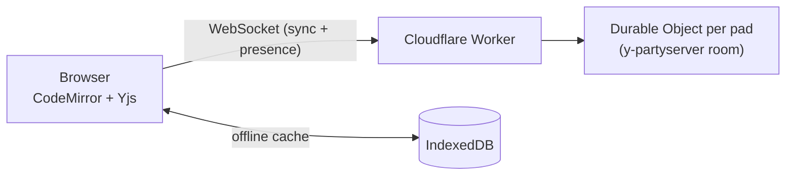

# Padline

**Open an address, type, and everyone on it sees it live.** A modern [Dontpad](http://dontpad.com): no account, no setup.

[](LICENSE)
[](https://workers.cloudflare.com/)

**Live at [padline.page](https://padline.page).**

Pads are public by design: anyone who knows an address can read and edit it. Use Padline for notes, lists and drafts you are happy to share, not for secrets.

## Features

- **URL-first.** `padline.page/anything-you-like` is the pad. Nothing is stored until the first keystroke.
- **Live.** Simultaneous edits merge without conflicts (Yjs). Presence shows who is on the pad.
- **Plain text with Markdown highlighting.** CodeMirror 6, fast on a phone.
- **Offline-safe.** Every visited pad is cached on the device; a dropped connection loses nothing and merges on reconnect.
- **Not trapped.** Download any pad as `.md` or `.txt`.
- **Light, dark and system themes**, in English, Portuguese, Spanish, French, German and Italian.
- **Lean moderation.** A public report form, and an operator page behind Cloudflare Access to empty or block a pad. No content is copied anywhere ([ADR-0002](docs/adr/0002-lean-moderation.md)).

## How it works

One Cloudflare Worker serves the static assets and a small HTTP surface. Each pad is one SQLite-backed Durable Object (a "room") that holds the live connections and the pad's document.



**Stack:** TypeScript · Vite · CodeMirror 6 · Yjs · y-codemirror.next · y-indexeddb · Cloudflare Workers · Durable Objects · y-partyserver.

## Quickstart

```sh
git clone https://github.com/idcesares/padline.git
cd padline
npm install
npm run dev        # http://127.0.0.1:8788
```

Open `http://127.0.0.1:8788/my-first-pad` in two tabs and type in one.

## Deploy your own

```sh
npx wrangler login
npm run deploy
```

Padline runs on the Cloudflare free tier. Point `wrangler.jsonc` at your own domain first; the steps are in [Self-hosting](docs/self-hosting.md). Whoever runs a public instance is responsible for what it hosts.

## Documentation

| | |
| --- | --- |
| [User guide](docs/user-guide.md) | Using pads: addresses, sharing, download, limits |
| [Self-hosting](docs/self-hosting.md) | Run locally, deploy, make it yours, troubleshoot |
| [Architecture](docs/architecture.md) | Modules, flows, storage, tests |
| [Reference](docs/reference/) | [HTTP and WebSocket](docs/reference/http-api.md) · [Configuration and limits](docs/reference/configuration.md) |
| [ADRs](docs/adr/) · [CONTEXT.md](CONTEXT.md) | Why each decision was made · the domain vocabulary |
| [Design spec](docs/design/mockup.html) | The approved clickable mockup |

## Contributing

See [CONTRIBUTING.md](CONTRIBUTING.md). Security issues: see [SECURITY.md](SECURITY.md).

## How this is built

Padline is written by AI coding agents under human product direction. Product decisions, architecture and trade-offs are human-owned and human-reviewed; the agents do implementation, refactoring and tests against specs written for them. [`docs/adr/`](docs/adr/) records every non-obvious decision, and [`AGENTS.md`](AGENTS.md) is the working contract the agents follow.

This describes how the software is written, not how it runs. Padline ships no AI features and makes no model calls; pad content never goes to a model.

## License & author

[MIT](LICENSE) © [Isaac D'Césares](https://github.com/idcesares).
