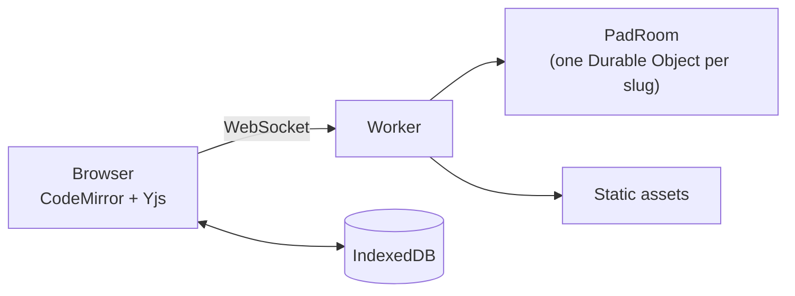

# Architecture

How Padline is built. For why, see the [ADRs](adr/); for exact names and codes, see the [reference](reference/).

## Overview

One Cloudflare Worker serves the static assets and a small HTTP surface, and routes WebSockets to one Durable Object per pad. The browser is a plain TypeScript app with no framework.

## Modules

| Path | Job |
| --- | --- |
| `shared/slug.ts` | Normalize and validate slugs, the reserved list, random slugs. Used by client and Worker. |
| `shared/limits.ts` | Every limit, close code and custom message, in one module. |
| `worker/index.ts` | Entry. Host redirect, `/parties` routing, `/api/health`, crawler previews, security headers, the HTML shell. |
| `worker/pad-room.ts` | `PadRoom`: connections, the Yjs document, persistence, limits, block enforcement, `?op=status`. |
| `worker/moderation.ts` | `/api/report` and the operator API under `/api/admin/*`: validation, D1 reads and writes, calls to the room. |
| `worker/access.ts` | Cloudflare Access JWT verification (RS256, cached JWKS); fails closed. |
| `shared/moderation.ts` | Report categories, field limits, admin filters. |
| `migrations/` | D1 schema: `pads`, `reports`, `actions`. |
| `worker/moderation-ledger.ts` | Inert placeholder for an applied migration; see [Configuration](reference/configuration.md#migrations). |
| `src/main.ts` | Router: landing or pad, by `location.pathname`. Disposes the previous view. |
| `src/landing.ts` | The landing page: address input, "Opens as ..." preview, random address, recent pads. |
| `src/editor.ts` | The pad: CodeMirror, Yjs, sync provider, presence, status, banners, menu, share dialog. |
| `src/preview.ts` | Markdown preview: the editor's Lezer parse rendered with DOM calls and `textContent` only, never as HTML. |
| `src/about.ts` | The static About page at `/about`. |
| `src/report.ts` | The public report form at `/report`. |
| `src/admin.ts` | The operator page at `/admin`, loaded as a separate chunk. |
| `src/notice.ts` | Full-screen states: reserved or invalid address, busy, removed. |
| `src/prefs.ts` | Theme, language, identity and recent pads, in localStorage. |
| `src/i18n.ts` | Strings for six languages (en, pt-BR, es, fr, de, it); `en` defines the keys and the others are typed against it ([ADR-0005](adr/0005-interface-languages.md)). |
| `src/style.css` | All styles, as design tokens plus components. |

## Flows

### Opening a pad

1. The Worker serves `index.html` for any page route (assets are served by Cloudflare directly, [ADR-0004](adr/0004-cloudflare-native-delivery-and-tests.md)).
2. `main.ts` normalizes the path into a slug. A reserved or invalid slug shows a notice; a path that differs from its normal form is rewritten in place.
3. `editor.ts` creates a `Y.Doc`, loads it from IndexedDB (`padline:<slug>`), mounts CodeMirror bound to the `text` Y.Text, and connects a `YProvider` to `/parties/pad-room/<slug>`.
4. The room validates the slug, checks for a block, checks the connection cap, then runs the standard Yjs sync handshake.

### Saving

The room persists the full document state under the `doc` key, debounced (about 2 seconds, at most every 10). An empty document is never persisted, so a typo or a crawler creates nothing. The client's status pill reads "saving" for a moment after a local edit, then "saved".

### Hitting the size limit

On save, if the state exceeds 1 MB the room stops persisting, stores `docOverCap`, and broadcasts `pad-full`; every client shows a banner. Edits keep working in the warm room and in each device cache. When a later save fits again the room persists, clears the flag, and broadcasts `pad-ok`. Past twice the limit the room becomes read-only to stop unbounded growth. See [ADR-0003](adr/0003-pad-lifecycle-and-limits.md).

### Offline

IndexedDB holds the document, so edits made offline are kept and merge on reconnect. The provider reconnects on its own; the status pill and an offline banner say so.

### Blocking

A block is a record under the `blocked` key. The room refuses new connections to a blocked slug with close code `4404`, and the client then asks `?op=status` for the category and date to show a removed notice. Nothing outside the room decides whether a pad is blocked ([ADR-0002](adr/0002-lean-moderation.md)).

### Pad index and admin

After the first non-empty save the room writes one row to the D1 `pads` table (slug, size, created, last edit, edit count), then at most once a minute, with an alarm to flush the last change. The index never holds content. The admin page, behind Cloudflare Access, lists pads from D1 and asks the room for a short excerpt. Clear and block go to the room first; the Worker then writes the `actions` row and the report updates in one D1 batch. A visitor's report goes to `reports` and answers the same way whether or not the pad exists.

## Storage

| Where | Key | Holds |
| --- | --- | --- |
| Durable Object storage | `doc` | Full Yjs state as one update |
| Durable Object storage | `docOverCap` | `true` while the pad is over the limit |
| Durable Object storage | `blocked` | `{ at, category?, reason? }` when blocked |
| IndexedDB (browser) | `padline:<slug>` | The local copy of a pad |
| localStorage (browser) | prefs keys | Theme, language, identity, recent pads |

## Security boundaries

- Pads are public. The boundary that matters is the room: it enforces slug validity, blocks, the connection cap, the message size and the document size.
- Room `admin-*` operations are refused on the public `/parties` route by the Worker.
- `/admin` and `/api/admin/*` require a valid Access JWT checked in the Worker, and same-origin `Origin` on `POST`. With the Access variables empty they answer `403`.
- The Content Security Policy forbids inline scripts; styles and fonts may come from Google Fonts. HSTS and the CSP are set in production only.
- Pad content never appears in logs or in link previews: the preview for a crawler is generic.

## Tests

`npm test` runs `test/slug.test.ts` (unit) and `test/worker.test.ts` (in `workerd`, against the real Durable Object): valid slugs stay connected, invalid and reserved slugs close with `4400`, `?op=status` answers, and `admin-*` ops return 404 on the public route. There is no browser test suite yet.
